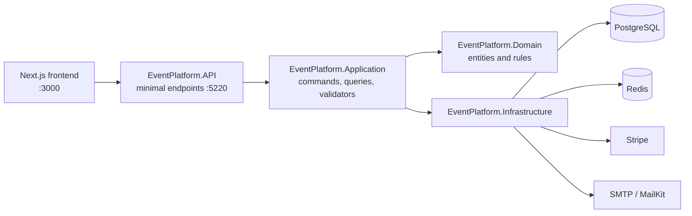

# EventPlatform

A full-stack event management platform: organizers publish events and ticket types, attendees register and pay, and staff check people in with a QR-code ticket.

> This repository is a **fork** of [Vakich1/EventPlatform](https://github.com/Vakich1/EventPlatform). Most of the history is from that project. Contributions on this fork include a frontend redesign, a richer event summary, check-in by registration id as well as QR payload, and non-blocking ticket email. Please treat it as a team project, not a solo build.

The repo already has an English README. This draft corrects a few details that no longer match the code (the frontend is Next.js 16 and React 19, not Next.js 14; `docker compose up` starts Postgres, Redis, the API, and the frontend; the API applies EF migrations and seed data on startup, so a separate `dotnet ef database update` is not required for a first run).

<!-- Screenshot: add a home or event-detail screenshot here, e.g.  -->

## Features

- **Events** — create, update, publish, and cancel events; add ticket types (free or paid). Event statuses include Draft, UnderReview, Published, Rejected, Cancelled, and Completed. A background service marks published events as completed after their end date.
- **Registration and tickets** — signed-in users register for an event, receive a ticket, and can view their registrations. A ticket confirmation email can include a QR code (needs working SMTP settings).
- **Payments** — Stripe payment intents, a confirm-payment endpoint, and a Stripe webhook at `/api/webhooks/stripe`.
- **Check-in** — organizers check attendees in from the dashboard. The check-in command accepts a QR payload or a registration id.
- **Authentication** — register, login, and refresh tokens (JWT + refresh tokens). Passwords are hashed with BCrypt.
- **Roles** — User, Organizer, and Admin. Organizer applications can be approved or rejected. Creating and managing events is authorization-protected.
- **Admin tools** — user list and detail, block/unblock, pending organizers, pending event reviews (approve/reject), cancel events or registrations, and basic stats. Matching pages live under `frontend/app/admin`.
- **Public catalog** — browse and filter events; event list queries are cached in Redis.
- **i18n** — the Next.js UI ships English and Russian strings.
- **Seed data** — on first migrate, the API seeds demo users (see `src/EventPlatform.Infrastructure/Persistence/DbSeeder.cs`) and sample events.

## Tech stack

### Backend

- ASP.NET Core **10** minimal APIs (`net10.0`)
- Clean Architecture + CQRS (**MediatR**), **FluentValidation** pipeline behavior
- **Entity Framework Core** + **PostgreSQL** (Npgsql)
- **JWT Bearer** authentication
- **Stripe.net**, **MailKit** / **MimeKit**, **QRCoder**
- **StackExchange.Redis** for event-list caching
- **Swashbuckle** (Swagger UI is enabled when the API runs in the Development environment)
- Docker (`Dockerfile` for the API)

### Frontend

- **Next.js 16** (standalone output) + **React 19** + **TypeScript**
- **Tailwind CSS 4**
- **React Hook Form** + **Zod**, **Axios**
- **qrcode.react**, **lucide-react**
- Node 20 in the frontend Docker image

### Tests and CI

- xUnit domain and validation-behavior tests under `tests/EventPlatform.UnitTests`
- GitHub Actions (`.github/workflows/ci.yml`): restore, Release build, and `dotnet test` on pushes and pull requests to `main`

## Architecture



- `EventPlatform.Domain` — entities (`User`, `Event`, `TicketType`, `Registration`, `Ticket`, `Payment`), statuses, and domain exceptions.
- `EventPlatform.Application` — MediatR commands/queries, validators, and interfaces (`ICacheService`, email, payments, current user).
- `EventPlatform.Infrastructure` — EF Core, migrations, seeder, JWT, Redis cache, Stripe, MailKit, QR codes, and the event-status background service.
- `EventPlatform.API` — endpoint maps for auth, events, registrations, payments, Stripe webhooks, and admin; exception middleware; CORS for `http://localhost:3000`.
- `frontend` — App Router pages for the public catalog, auth, organizer dashboard (including check-in and event manage), and admin.

## How to run

Prerequisites: **Docker**, or **.NET 10 SDK** + **Node.js 20.9+** (the frontend Dockerfile uses Node 20) if you run the apps on the host.

### Option A — full stack with Docker

From the repository root:

```bash
docker compose up --build
```

This starts PostgreSQL (`5432`), Redis (`6379`), the API (`http://localhost:5220`), and the frontend (`http://localhost:3000`). The API runs `Database.MigrateAsync()` and `DbSeeder.SeedAsync()` at startup.

Paid tickets and ticket emails need real `StripeSettings` and `EmailSettings` (compose ships placeholders). Swagger is **not** turned on in the compose API container, because `ASPNETCORE_ENVIRONMENT` is not set to Development there.

### Option B — API and frontend on the host

1. Start only the data stores:

```bash
docker compose up -d postgres redis
```

2. Run the API (Development, so Swagger is available at `http://localhost:5220/swagger`):

```bash
dotnet run --project src/EventPlatform.API
```

`appsettings.json` already points at `localhost` Postgres and Redis. You can override secrets with `appsettings.Development.json` if you want; it is not in the repo. A separate `dotnet ef database update` is optional: the API migrates on startup.

3. Run the frontend:

```bash
cd frontend
npm install
npm run dev
```

Then open `http://localhost:3000`. Other scripts in `frontend/package.json`: `npm run build`, `npm start`, `npm run lint`.

### Tests

```bash
dotnet test
```

(from the repository root, against `EventPlatform.sln`).

## Project structure

```
EventPlatform.sln
docker-compose.yml          # postgres, redis, api, frontend
Dockerfile                  # API image
.github/workflows/ci.yml
src/EventPlatform.API/      # endpoints, middleware, appsettings
src/EventPlatform.Application/
src/EventPlatform.Domain/
src/EventPlatform.Infrastructure/
frontend/                   # Next.js app
tests/EventPlatform.UnitTests/
```
